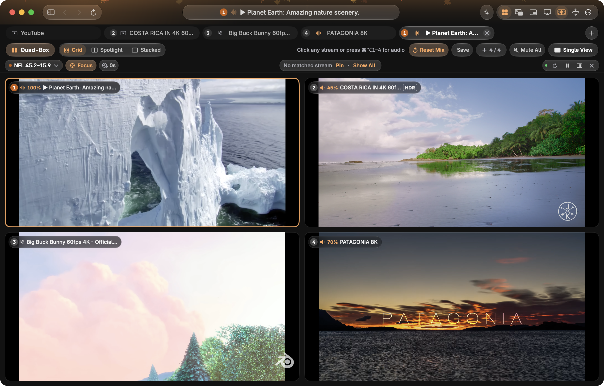
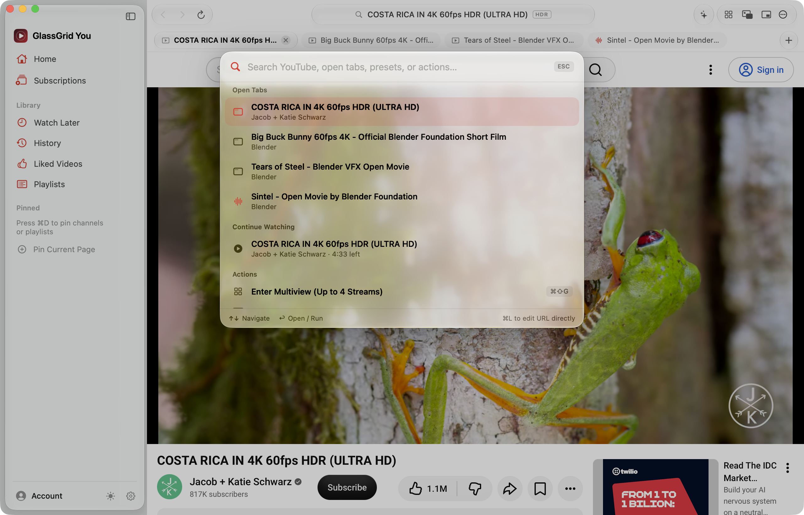
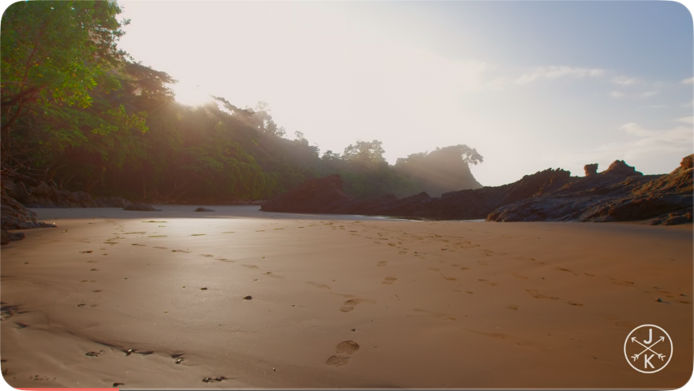

# GlassGrid You for macOS

**A native, distraction-free macOS client for YouTube & YouTube TV — built with Swift 6, SwiftUI, AppKit, and WebKit.**

🌐 **Official Website:** **[glassgridyou.com](https://glassgridyou.com)**

[](https://github.com/ZacharyZell/glassgrid-you/actions/workflows/ci.yml)
-000000?logo=apple)


> **Disclaimer:** GlassGrid You is an unofficial, independent, open-source macOS application for YouTube and YouTube TV. It is not affiliated with, endorsed by, or sponsored by Google LLC or YouTube.

<p align="center">
  <a href="https://buy.polar.sh/polar_cl_hrRm8ICI2Rcxj2eekSvW7EA6mN6GQHzJypUaN4AEVYb">
    
  </a>
  &nbsp;
  <a href="#build--install">
    
  </a>
</p>

<p align="center">
  
</p>

---

## Why GlassGrid You?

Browser tabs bury YouTube behind cluttered web chrome, drain battery with ambient glow and Shorts feeds, and struggle to feel like a real Mac app. **GlassGrid You** wraps YouTube and YouTube TV in an Apple-grade native SwiftUI + AppKit shell with zero Electron overhead — keeping full 4K 60fps HDR10 playback, native Safari desktop User-Agent compatibility, Google Sign-In, YouTube Premium, and FairPlay DRM rock-solid.

---

## Highlights & Screenshots

### Native Multiview Mode (2-Up, 3-Up & 2×2 Quad-Box + Companion Web Tiles)
Watch up to **4 simultaneous YouTube, YouTube TV, and Companion Web streams** (Twitch, ESPN Scores, NFL.com, Peacock, Paramount+, Prime Video, or any HTTPS URL) in **Grid**, **Spotlight**, or **Stacked** layouts with **120Hz draggable custom tile dividers** (double-click to reset), single-stream crimson audio focus, optional 15% background audio ducking, per-tile reorder controls, a configurable Multiview quality ceiling (Auto / 1080p / 720p), and one-click **Saved Multiview Presets** that remember custom split ratios.

<p align="center">
  
</p>

### Spotlight Command Palette (`⌘K`) & Day/Night Liquid Glass
Jump straight to open tabs, Continue Watching history, pinned channels, saved Multiview presets, app actions, or live cookieless YouTube search suggestions — rendered in native macOS 26/27 **Liquid Glass** with clean `.regularMaterial` fallback on macOS 14–15.

<p align="center">
  
</p>

### Smart Floating Mini-Player (`⌘⇧M`)
Borderless, always-on-top floating 16:9 Mini-Player with magnetic corner snapping, **Compact / Standard / Large** size presets, an ultra-thin `2pt` progress hairline, `Esc` quick dock, optional cross-Spaces visibility, and **Split Screen–aware** auto pop-out (stays docked while you work side-by-side in Split View, pops out only when another app covers the window).

<p align="center">
  
</p>

---

## Complete Feature Set

### Native macOS Experience
- **Liquid Glass Chrome**: Uses macOS 26/27 `.glassEffect` & `GlassEffectContainer` when compiled with Swift 6.2+ SDKs, and gracefully falls back to native `.regularMaterial` on macOS 14–15.
- **Multi-Window Support (`⌘N`)**: Open independent windows across multiple displays (`Open in New Window`, `Launch Preset in New Window`) with per-window Multiview, shared settings & Day/Night theme sync, dynamic window titles, and a single conflict-free Floating Mini-Player.
- **Custom Sidebar Channel Folders**: Group pinned channels, playlists, and Companion sites into collapsible sidebar folders with 1-click **Open in Multiview**, non-destructive folder deletion, and `⌘K` Command Palette search.
- **Sparkle 2 Silent Auto-Updates**: Signed releases include embedded Sparkle 2 EdDSA-verified auto-updates (with zero-dependency GitHub Releases fallback on source builds and forks).
- **Multi-Tab Architecture & Session Restoration**: Keeps background tab audio alive, supports drag-to-reorder, middle-click close, manual **Sleep Tab** (`Unload Page`), reopen closed tab (`⌘⇧T`), and lazy session restoration across launches.
- **Control Center Menu Bar**: Compact now-playing popover with 16:9 thumbnail, live interactive timeline scrubber, transport controls, chapter jump menu, Multiview audio switcher, and Sleep Timer.
- **System-Aware Auto-Pause**: Automatically pauses playback on AirPods/headphone disconnect (CoreAudio listener), screen lock, or macOS sleep — configurable in Settings.
- **Sleep Timer**: Countdown timers (15m, 30m, 45m, 60m, or **End of Current Video**) accessible from the Playback menu, Menu Bar, and Dock menu.
- **Dock Menu, Share Sheet & macOS Services**: Right-click the Dock icon for quick controls, share clean or timestamped links via `NSSharingServicePicker`, drag YouTube links onto the toolbar/tab strip, or right-click any YouTube link in another app → **Services → Open in GlassGrid You**.
- **Native In-Page Find (`⌘F`)**: Liquid Glass floating find bar powered by WebKit's native `WKFindConfiguration` with next/previous match cycling and `Esc` dismissal.
- **Clean Video Frame Capture**: Copy (`Copy Video Frame`) or save (`Save Video Frame…`) the current crisp video frame directly to the clipboard or PNG, with automatic DRM protection handling for YouTube TV.

### Playback, Multiview & Distraction-Free Controls
- **4K 60fps HDR10 & Hybrid WebKit Engine**: Native Safari desktop User-Agent, persistent WebKit cookie store for Google Sign-In and YouTube Premium, full YouTube player settings menu, and clean YouTube TV (`tv.youtube.com`) FairPlay DRM support.
- **Focus Mode (`⌘⇧F`) & Cinema Chrome Dimming**: Hides watch recommendations and comments and gently fades top chrome while you watch, restoring smoothly on hover.
- **Distraction-Free Defaults**: Hide YouTube Shorts shelves & links, redirect `/shorts/` URLs to the standard watch player, strip redundant web chrome & end-screen teasers, disable GPU-heavy Ambient Mode glow, prefer original audio tracks (avoiding auto-dubbing), and auto-dismiss YouTube's *"Continue watching?"* pause prompt.
- **Dynamic Video Chapters**: Automatically extracts YouTube chapters into the **Playback → Chapters** menu and Menu Bar popover for one-click seeking.
- **Privacy-Preserving Opt-In Integrations**:
  - **SponsorBlock (off by default)**: Queries `sponsor.ajay.app` using only a 4-character SHA-256 video ID prefix; fails silently offline.
  - **Live Search Autocomplete (`⌘K`)**: Uses an ephemeral, cookieless `URLSession` with short timeouts and a toggle in Settings.

---

## Keyboard Shortcuts

Every shortcut below matches the native macOS menu bar in [`YouTubeMacApp.swift`](Sources/YouTubeMac/YouTubeMacApp.swift):

### File, Windows & Tabs
| Shortcut | Action |
| :--- | :--- |
| `⌘N` | New Window |
| `⌘T` | New Tab |
| `⌘W` | Close Tab |
| `⌘⇧W` | Close Window |
| `⌘⇧T` | Reopen Closed Tab |
| `⌘⇧]` / `⌘⇧[` | Next / Previous Tab |
| `⌘1` – `⌘9` | Jump to Tab 1–9 |
| `⌘⇧V` | Open YouTube URL from Clipboard |
| `⌘⇧C` | Copy Current Link |
| `⌘⌥C` | Copy Link at Current Time |
| `⌘⇧O` | Open Current Page in Default Browser |

### Navigation & Search
| Shortcut | Action |
| :--- | :--- |
| `⌘K` | Command Palette & Search |
| `⌘L` | Focus URL Bar |
| `⌘F` / `⌘G` | Find on Page / Find Next |
| `⌘[` / `⌘]` | Back / Forward |
| `⌘R` | Reload / Stop Page |
| `⌘⇧H` | Home |
| `⌘⇧S` | Subscriptions |
| `⌘⌥L` | Watch Later |
| `⌘Y` | History |
| `⌘D` | Pin / Unpin Current Page |

### Playback & Window
| Shortcut | Action |
| :--- | :--- |
| `⌘\` | Play / Pause |
| `⌘⌥M` | Mute / Unmute |
| `⌘⇧P` | Picture in Picture |
| `⌘⇧M` | Toggle Floating Mini-Player (`Esc` to dock) |
| `⌘⌥P` | Toggle Always on Top |
| `⌘⇧F` | Toggle Focus Mode |
| `⌘⌥T` | Toggle Theater Mode |
| `⌘⌥]` / `⌘⌥[` / `⌘⌥0` | Playback Speed +0.1× / −0.1× / Reset 1× |

### Multiview
| Shortcut | Action |
| :--- | :--- |
| `⌘⇧G` | Enter / Exit Multiview |
| `⌘⌥G` | Cycle Layout (Grid / Spotlight / Stacked) |
| `⌘⌥1` – `⌘⌥4` | Focus Audio on Stream 1–4 |
| `⌘⌥→` / `⌘⌥←` | Next / Previous Stream Audio |

### View
| Shortcut | Action |
| :--- | :--- |
| `⌘⌥S` | Toggle Sidebar |
| `⌘⇧L` | Switch Day / Night Mode |
| `⌘=` / `⌘-` / `⌘0` | Zoom In / Zoom Out / Actual Size |

---

## Requirements

- **macOS 14.0 (Sonoma)** or later *(authentic Liquid Glass on macOS 26+; `.regularMaterial` fallback on macOS 14–15)*
- **Xcode 16+** / **Swift 6.0+** toolchain (macOS Command Line Tools or full Xcode)

---

## Download & Support

GlassGrid You's source code is **100% open-source under the MIT License** — with zero telemetry, zero subscriptions, and zero paywalls.

- **Signed & Apple-Notarized `.dmg` ($12 One-Time):** [Download GlassGrid You for macOS on Polar](https://buy.polar.sh/polar_cl_hrRm8ICI2Rcxj2eekSvW7EA6mN6GQHzJypUaN4AEVYb) — instant Gatekeeper-trusted macOS installer (`v1.1.1`, macOS 14.0+) with no Xcode or build steps required, directly supporting ongoing macOS & WebKit maintenance.
- **Build Free from Source (MIT):** Clone this repository and run `./scripts/bundle.sh` (see [Build & Install](#build--install) below).
- **Support Development:** You can also support ongoing development via [GitHub Sponsors](https://github.com/sponsors/ZacharyZell). Maintainers packaging signed & notarized releases can run `./scripts/release-dmg.sh` (see [`docs/RELEASING.md`](docs/RELEASING.md)).

---

## Build & Install

```bash
git clone https://github.com/ZacharyZell/glassgrid-you.git
cd glassgrid-you

# Run unit tests (Swift 6 strict concurrency)
swift test

# Build release binary, generate Liquid Glass AppIcon.icns, sign, and install to /Applications
./scripts/bundle.sh
```

This installs **`/Applications/GlassGrid You.app`** (bundle identifier `com.glassgridyou.mac`, URL scheme `glassgridyou://`).

> **Code Signing & Gatekeeper Note:** `./scripts/bundle.sh` performs an ad-hoc code signature (`codesign --force --sign -`) intended for local builds on your own Mac. To build a Hardened Runtime signed & notarized `.dmg` for distribution, use `./scripts/release-dmg.sh` (see [`docs/RELEASING.md`](docs/RELEASING.md)).

---

## Architecture & Engineering Invariants

GlassGrid You is organized into two Swift Package Manager targets plus a unit test suite:

- **`Sources/YouTubeMacCore`**: Pure Swift 6 testable domain logic (`YouTubeURLRouter`, `EnhancementScript`, `MultiviewLayout`, `CommandPaletteEngine`, `SponsorBlockClient`, `YouTubeSuggestClient`, `VideoChapterParser`, `SessionModels`, `MiniPlayerGeometry`, `WindowOcclusion`, `UpdateChecker`, `SparkleConfiguration`, `WindowTitleFormatter`).
- **`Sources/YouTubeMac`**: Native SwiftUI + AppKit + WebKit application (`AppCoordinator`, `AppController`, `BrowserTab`, `TabWebViewHost`, `FloatingMiniPlayerController`, `SystemPlaybackGuard`, `SparkleUpdaterManager`, `MultiviewView`, `CommandPaletteView`, `MenuBarView`, `SettingsView`, `AppleChrome`).
- **`Tests/YouTubeMacCoreTests`**: Unit tests covering routing, URL parsing, enhancement script generation, multiview layouts, SponsorBlock prefix hashing, command palette ranking, chapter parsing, and session persistence.

Key engineering invariants enforced in code and CI (see [`AGENTS.md`](AGENTS.md)):
1. **Zero CSS `:has(` selectors** and **zero `MutationObserver` loops** in injected page scripts to preserve smooth 4K 60fps HDR10 compositing.
2. **Zero `AudioContext` hijacking** and **zero `ytInitialPlayerResponse` mutation** — WebKit's native AVFoundation / FairPlay DRM pipeline stays completely untouched.
3. **Strict fullscreen immutability** — `TabWebViewHost` never mutates `WKWebView` hierarchies while any tab is in native macOS video fullscreen.
4. **Swift 6 strict concurrency** — zero warnings and zero errors across debug and release builds.

---

## Privacy & Data

- All cookies and sign-in state live exclusively in Apple's native WebKit persistent `WKWebsiteDataStore` on your Mac.
- Local history (Continue Watching, Most Watched Channels, Saved Multiview Presets) is stored locally in `UserDefaults` and can be cleared anytime in **Settings → Account & Data**.
- No analytics, telemetry, crash-reporting SDKs, or third-party trackers are included.

---

## Contributing & License

Pull requests and issue reports are welcome! Before opening a PR, please review [`AGENTS.md`](AGENTS.md) and ensure `swift test` and `swift build -c release` pass with zero warnings.

Released under the [MIT License](LICENSE).
