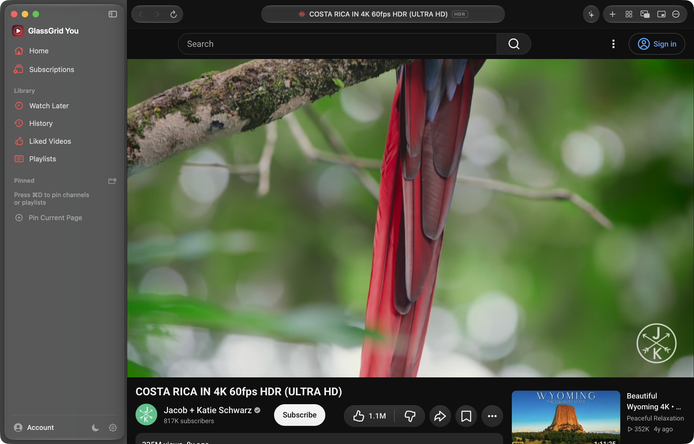
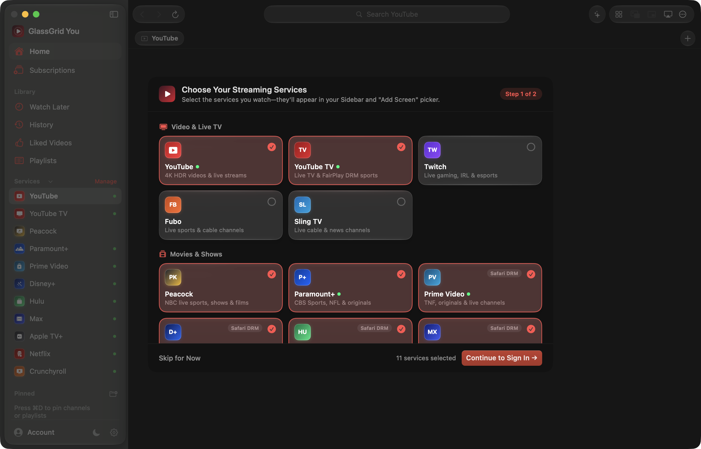
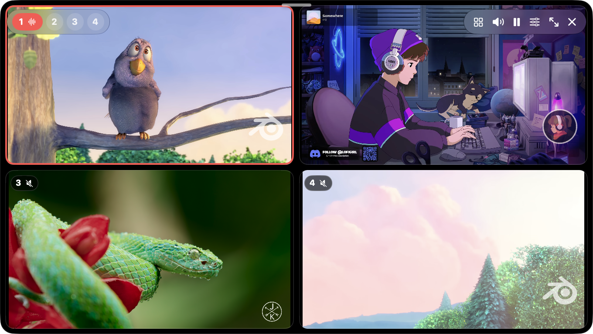
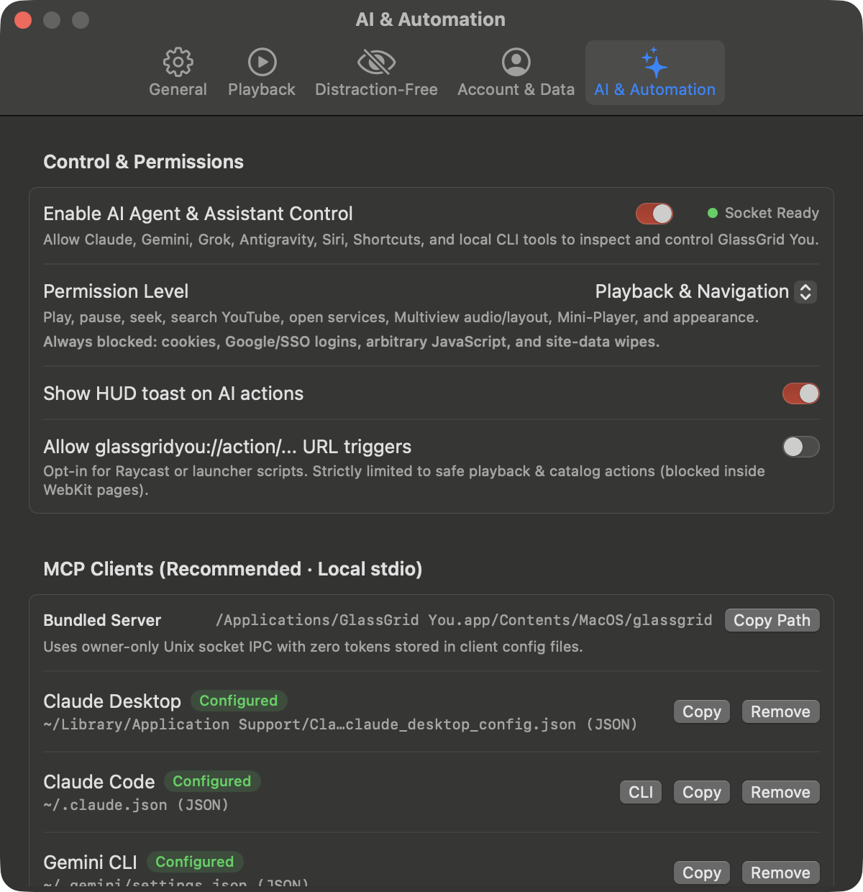
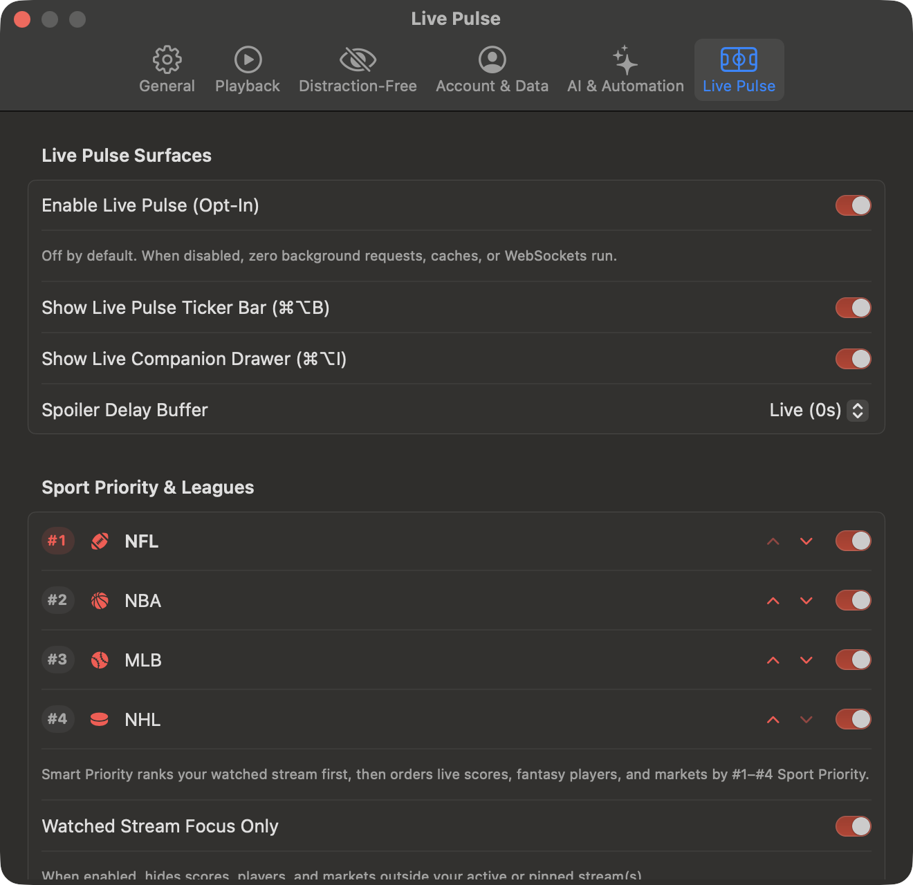

# GlassGrid You for macOS

**A native, distraction-free macOS client for YouTube & YouTube TV — built with Swift 6, SwiftUI, AppKit, and WebKit.**

🌐 **Official Website:** **[glassgridyou.com](https://glassgridyou.com)** · 📋 **Release Log:** **[glassgridyou.com/changelog.html](https://glassgridyou.com/changelog.html)**

[](https://github.com/ZacharyZell/glassgrid-you/actions/workflows/ci.yml)
-000000?logo=apple)


> **Disclaimer:** GlassGrid You is an unofficial, independent, open-source macOS application for YouTube and YouTube TV. It is not affiliated with, endorsed by, or sponsored by Google LLC or YouTube.

<p align="center">
  <a href="https://buy.polar.sh/polar_cl_hrRm8ICI2Rcxj2eekSvW7EA6mN6GQHzJypUaN4AEVYb">
    
  </a>
  &nbsp;
  <a href="#build--install">
    
  </a>
</p>

<p align="center">
  
</p>

---

## Why GlassGrid You?

Browser tabs bury YouTube behind cluttered web chrome, drain battery with ambient glow and Shorts feeds, and struggle to feel like a real Mac app. **GlassGrid You** wraps YouTube, YouTube TV, and 18 built-in streaming services in an Apple-grade native SwiftUI + AppKit shell with zero Electron overhead — pairing **Universal Clean-Box** playback, a **Floating Multiview Grid**, opt-in **Live Pulse** (live sports scoreboards, fantasy matchups & read-only odds), and optional local **AI / MCP / CLI / Siri** control with full 4K 60fps HDR10 video, native Safari desktop User-Agent compatibility, Google Sign-In, YouTube Premium, and FairPlay DRM.

---

## Highlights & Screenshots

### Native Multiview Mode (2-Up, 3-Up & 2×2 Quad-Box + Solo Tile + Live Sync)
Watch up to **4 simultaneous YouTube, YouTube TV, Twitch, live sports, and streaming service feeds** in **Grid**, **Spotlight**, or **Stacked** layouts with **Universal Clean-Box (`⌘⇧B`)** inside each tile, narrow-viewport YouTube live chat suppression so chat panels never cover compact tiles, **120Hz draggable custom tile dividers** (double-click to reset), **Zero-Latency Multiview Solo (`⌘⌥Z` / `Esc`)** that keeps all other tiles live in the background and snaps back instantaneously with your split ratios intact, **Live Stream Sync micro-nudge** (`−5s`, `−1s`, `+1s`, `Jump to Live`) per tile, single-stream crimson audio focus, optional 15% background audio ducking, a configurable Multiview quality ceiling (Auto / 1080p / 720p), and one-click **Saved Multiview Presets**.

<p align="center">
  
</p>

### Universal Clean-Box (`⌘⇧B`), 18-Service Streaming Hub & Native AirPlay
Select from **18 built-in streaming services** across *Video & Live TV*, *Movies & Shows*, and *Live Sports* (11 native WKWebView + 7 Safari-DRM-badged — including YouTube, YouTube TV, **Crunchyroll**, **HBO Max** (`play.hbomax.com`), **Disney+** & **Hulu** (with MyDisney SSO isolation), **Prime Video** across 18 regional storefronts, **Apple TV+**, **Netflix**, **Peacock**, and **Paramount+**) during Liquid Glass onboarding or anytime from the Sidebar, Multiview **Add Screen**, or `⌘K`.

On active watch pages, **Universal Clean-Box (`⌘⇧B`)** automatically isolates only the video player container edge-to-edge across all 18 services (including cross-origin iframes like Crunchyroll Vilos, inline Katamari players, Shadow DOM players like Apple TV+ and Disney+, and overlay SDK players like Prime Video) while keeping browse, guide, home, and login pages untouched — plus SPA auth-exit lazy script recovery, blocked app-handoff URI schemes, native OAuth popups, honest **Safari DRM** 1-click fallbacks, and **Native AirPlay** video & display casting.

<p align="center">
  
</p>

### Floating Mini-Player & Floating Multiview Grid (`⌘⇧M`)
Switch apps or press `⌘⇧M` while watching Multiview and your entire **2-up, 3-up, or 2×2 Quad-Box grid** floats into an always-on-top, borderless 16:9 panel with zero reload — featuring crimson active-audio borders, click-any-tile audio focus, a compact `44pt` hover header, Display Options popover (**40%–100% opacity**, Grid / Spotlight / Stacked layouts, Play/Pause All), Grid size presets (**Compact 540×304**, **Standard 680×383**, **Large 880×495**; minimum 440×248), magnetic corner snapping, and **Split Screen–aware** auto pop-out & dock.

<p align="center">
  
</p>

Watching a single video? The single-stream 16:9 Mini-Player supports YouTube, YouTube TV, Twitch, ESPN, Peacock, and open Shadow DOM HTML5 players with **40%–100% transparency**, **0.5×–2.0× speed controls**, **AirPlay casting**, **Compact / Standard / Large** size presets, an ultra-thin `2pt` progress hairline, `Esc` quick dock, and optional cross-Spaces visibility.

<p align="center">
  
</p>

### Local AI Agent Control (MCP Server, `glassgrid` CLI & Siri / Shortcuts)
Control playback, tabs, services, Multiview layouts, and appearance from your favorite AI coding assistant, terminal, or Siri (**strictly OFF by default** under **Settings → AI & Automation**):
- **Local MCP Server (`28` tools, `5` read-only resources):** Supports MCP `2025-06-18` / `2025-03-26` / `2024-11-05` with **zero-GUI-launch offline discovery** and 1-click config installation for **Claude Desktop**, **Claude Code**, **Gemini CLI**, **Antigravity**, and **Grok CLI**, plus opt-in Streamable HTTP (`127.0.0.1:41773/mcp`) with a 256-bit Bearer token and 100-entry Activity Log.
- **Standalone `glassgrid` CLI:** Zero AppKit/WebKit/Sparkle linkage communicating over an owner-only UNIX socket (`0600` in `0700` with `getpeereid` EUID check), with natural service aliases (`hbomax`, `disney+`, `appletv+`, etc.).
- **Siri, Apple Intelligence & Shortcuts:** **12 native App Intents** and **8 App Shortcuts** compiled into `Metadata.appintents`, plus opt-in `glassgridyou://action/...` URL triggers.
- **Fail-Closed Privacy Guardrails:** Cookies, SSO logins, transient auth flows, payment URLs, arbitrary JS execution, and site-data wipes are permanently blocked from automation.

<p align="center">
  
</p>

### Spotlight Command Palette (`⌘K`) & Day/Night Liquid Glass
Jump straight to open tabs, enabled Streaming Services (including aliases like `hbo`, `max`, `apple`), Add-to-Multiview actions, Continue Watching history, pinned channels, saved Multiview presets, app actions, or live cookieless YouTube search suggestions — rendered in native macOS 26/27 **Liquid Glass** with clean `.regularMaterial` fallback on macOS 14–15.

<p align="center">
  
</p>

### Live Pulse: Sports Scoreboards, Fantasy & Read-Only Markets (`⌘⌥B` / `⌘⌥I`)
Follow live NFL, NBA, MLB, and NHL scoreboards, your fantasy matchups, and strictly read-only implied odds alongside your stream (**strictly OFF by default** under **Settings → Live Pulse**):
- **Reactive Stream Detection & 90s Ad-Break Hysteresis:** Automatically matches active YouTube, YouTube TV, Prime Video, Peacock, Paramount+, ESPN+, NFL+, MLB.tv, NBA, and Apple TV+ streams (plus RedZone, Big Inning, CrunchTime, and Frozen Frenzy whip-around slates) locally using passive `navigator.mediaSession`, `og:title`, watch `h1`, and URL metadata (with strict auth-page bailout)—auto-binding national single-game broadcasts (`Auto · NBC`, `Auto · Prime Video`), offering 1-click regional disambiguation on multi-game networks (`CBS`/`FOX`), and holding context across 90-second commercial breaks.
- **Starter vs. Bench (`BN`) UX & Compact 1-Line Boxscores:** Matchup totals count Starters only while live Bench (`BN`) players surface cleanly with a 4-cue hollow `BN` treatment in a collapsed Matchup Bench disclosure (`Bench (N · M live)`), an inline **Bench** toggle chip in **Players**, and a capped hollow `BN` Ticker slot—paired with sport/category-aware 1-line boxscores (NFL `QB`/`RB`/`WR`/`TE`/`K`/`D/ST`, NBA, MLB, NHL) and diacritic/suffix-insensitive name+team fallback matching for rookies without an `espn_id`.
- **Custom Sport Priority & Watched Stream Focus:** Order NFL, NBA, MLB, and NHL priority (`#1–#4`) in **Settings → Live Pulse** (or right-click league pills) to rank Ticker, Players, Scores, and Markets, or toggle **Watched Stream Focus** (`Focus`) in 1 click to isolate only your active stream's game(s).
- **Liquid Glass Ticker Bar (`⌘⌥B`) & Companion Drawer (`⌘⌥I`):** Toggle a compact `30pt` floating pill rail above the player or a resizable `280–440pt` trailing Companion Drawer with **Matchup**, **Players**, **Scores**, and **Markets** tabs, 15s-bucketed freshness (`Live` / `Synced` / `<1m` / `2m` / `5m+` / `Offline`), debounced 1-click refresh, and 1-click **Open in Tile** launchers for **Sleeper**, **ESPN Fantasy**, **Yahoo Fantasy**, **NFL Fantasy**, **Kalshi**, and **Polymarket**.
- **Configurable Spoiler Delay Buffer (`0s` / `20s` / `35s`) & Strictly Read-Only Privacy:** Delay live score deltas, fantasy scoring changes, and market probability ticks so broadcast latency never spoils plays ahead of your video stream. Uses dedicated cookieless ephemeral `URLSession` requests (zero access to WebKit cookies or sign-in state) and performs zero order execution, wallet signing, or wagering anywhere in code.

<p align="center">
  
</p>

---

## Complete Feature Set

### Native macOS Experience
- **Liquid Glass Chrome**: Uses macOS 26/27 `.glassEffect` & `GlassEffectContainer` when compiled with Swift 6.2+ SDKs, and gracefully falls back to native `.regularMaterial` on macOS 14–15.
- **Multi-Window Support (`⌘N`)**: Open independent windows across multiple displays (`Open in New Window`, `Launch Preset in New Window`) with per-window Multiview, shared settings & Day/Night theme sync, dynamic window titles, and a single conflict-free Floating Mini-Player.
- **Custom Sidebar Channel Folders**: Group pinned channels, playlists, and Companion sites into collapsible sidebar folders with 1-click **Open in Multiview**, non-destructive folder deletion, and `⌘K` Command Palette search.
- **Sparkle 2 Silent Auto-Updates**: Signed releases include embedded Sparkle 2 EdDSA-verified auto-updates (with zero-dependency GitHub Releases fallback on source builds and forks).
- **Multi-Tab Architecture & Session Restoration**: Keeps background tab audio alive, supports drag-to-reorder, middle-click close, manual **Sleep Tab** (`Unload Page`), reopen closed tab (`⌘⇧T`), and lazy session restoration across launches.
- **Control Center Menu Bar**: Compact now-playing popover with 16:9 thumbnail, live interactive timeline scrubber, transport controls, chapter jump menu, Multiview audio switcher, and Sleep Timer.
- **System-Aware Auto-Pause**: Automatically pauses playback on AirPods/headphone disconnect (CoreAudio listener), screen lock, or macOS sleep — configurable in Settings.
- **Sleep Timer**: Countdown timers (15m, 30m, 45m, 60m, or **End of Current Video**) accessible from the Playback menu, Menu Bar, and Dock menu.
- **Dock Menu, Share Sheet & macOS Services**: Right-click the Dock icon for quick controls, share clean or timestamped links via `NSSharingServicePicker`, drag YouTube links onto the toolbar/tab strip, or right-click any YouTube link in another app → **Services → Open in GlassGrid You**.
- **Native In-Page Find (`⌘F`)**: Liquid Glass floating find bar powered by WebKit's native `WKFindConfiguration` with next/previous match cycling and `Esc` dismissal.
- **Clean Video Frame Capture**: Copy (`Copy Video Frame`) or save (`Save Video Frame…`) the current crisp video frame directly to the clipboard or PNG, with automatic DRM protection handling for YouTube TV.

### Playback, Multiview & Distraction-Free Controls
- **4K 60fps HDR10 & Hybrid WebKit Engine**: Native Safari desktop User-Agent, persistent WebKit cookie store for Google Sign-In and YouTube Premium, full YouTube player settings menu, and clean YouTube TV (`tv.youtube.com`) FairPlay DRM support.
- **Universal Clean-Box (`⌘⇧B`) & SPA Auth Recovery**: Automatically fits video players edge-to-edge on watch pages across all 18 streaming services while keeping login, browse, and guide pages untouched, tearing down cleanly on auth/MFA/CAPTCHA flows and lazily recovering after single-page sign-in transitions.
- **Live Pulse (`⌘⌥B` / `⌘⌥I`)**: Opt-in (**OFF by default**) NFL, NBA, MLB, and NHL live scoreboards, Sleeper & ESPN Public fantasy matchup tracking (with Starter vs. hollow `BN` Bench differentiation and sport-aware 1-line boxscores), custom `#1–#4` Sport Priority + 1-click Watched Stream Focus, strictly read-only Kalshi & Polymarket odds, configurable `0s`/`20s`/`35s` Spoiler Delay buffering, 15s-bucketed freshness + manual refresh, 1-click Manual Game Pin, and 6 Fantasy/Markets Companion Quick-Launch tiles.
- **Floating Multiview Grid (`⌘⇧M`) & Split Screen Awareness**: Floats single videos or full 2–4 stream Multiview Grids when leaving or covering the app, while staying docked during side-by-side Split Screen viewing.
- **AI & Automation (`Settings → AI & Automation`)**: Opt-in local UNIX-socket & Streamable HTTP MCP server (`28` tools, `5` resources), standalone `glassgrid` CLI, 1-click config installers for Claude Desktop / Claude Code / Gemini CLI / Antigravity / Grok CLI, and 12 Siri App Intents.
- **Focus Mode (`⌘⇧F`) & Cinema Chrome Dimming**: Hides watch recommendations and comments and gently fades top chrome while you watch, restoring smoothly on hover.
- **Distraction-Free Defaults**: Hide YouTube Shorts shelves & links, redirect `/shorts/` URLs to the standard watch player, strip redundant web chrome & end-screen teasers, disable GPU-heavy Ambient Mode glow, prefer original audio tracks (avoiding auto-dubbing), and auto-dismiss YouTube's *"Continue watching?"* pause prompt.
- **Dynamic Video Chapters**: Automatically extracts YouTube chapters into the **Playback → Chapters** menu and Menu Bar popover for one-click seeking.
- **Privacy-Preserving Opt-In Integrations**:
  - **SponsorBlock (off by default)**: Queries `sponsor.ajay.app` using only a 4-character SHA-256 video ID prefix; fails silently offline.
  - **Live Search Autocomplete (`⌘K`)**: Uses an ephemeral, cookieless `URLSession` with short timeouts and a toggle in Settings.

---

## Keyboard Shortcuts

Every shortcut below matches the native macOS menu bar in [`YouTubeMacApp.swift`](Sources/YouTubeMac/YouTubeMacApp.swift):

### File, Windows & Tabs
| Shortcut | Action |
| :--- | :--- |
| `⌘N` | New Window |
| `⌘T` | New Tab |
| `⌘W` | Close Tab |
| `⌘⇧W` | Close Window |
| `⌘⇧T` | Reopen Closed Tab |
| `⌘⇧]` / `⌘⇧[` | Next / Previous Tab |
| `⌘1` – `⌘9` | Jump to Tab 1–9 |
| `⌘⇧V` | Open YouTube URL from Clipboard |
| `⌘⇧C` | Copy Current Link |
| `⌘⌥C` | Copy Link at Current Time |
| `⌘⇧O` | Open Current Page in Default Browser |

### Navigation & Search
| Shortcut | Action |
| :--- | :--- |
| `⌘K` | Command Palette & Search |
| `⌘L` | Focus URL Bar |
| `⌘F` / `⌘G` | Find on Page / Find Next |
| `⌘[` / `⌘]` | Back / Forward |
| `⌘R` | Reload / Stop Page |
| `⌘⇧H` | Home |
| `⌘⇧S` | Subscriptions |
| `⌘⌥L` | Watch Later |
| `⌘Y` | History |
| `⌘D` | Pin / Unpin Current Page |

### Playback & Window
| Shortcut | Action |
| :--- | :--- |
| `⌘\` | Play / Pause |
| `⌘⌥M` | Mute / Unmute |
| `⌘⇧P` | Picture in Picture |
| `⌘⇧M` | Toggle Floating Mini-Player / Multiview Grid (`Esc` to dock) |
| `⌘⌥P` | Toggle Always on Top |
| `⌘⇧F` | Toggle Focus Mode |
| `⌘⌥T` | Toggle Theater Mode |
| `⌘⇧B` | Toggle Clean-Box / Full Page |
| `⌘⌥]` / `⌘⌥[` / `⌘⌥0` | Playback Speed +0.1× / −0.1× / Reset 1× |

### Multiview
| Shortcut | Action |
| :--- | :--- |
| `⌘⇧G` | Enter / Exit Multiview |
| `⌘⌥G` | Cycle Layout (Grid / Spotlight / Stacked) |
| `⌘⌥Z` | Solo / Expand Focused Multiview Tile (`Esc` to return to Grid) |
| `⌘⌥1` – `⌘⌥4` | Focus Audio on Stream 1–4 |
| `⌘⌥→` / `⌘⌥←` | Next / Previous Stream Audio |

### View
| Shortcut | Action |
| :--- | :--- |
| `⌘⌥S` | Toggle Sidebar |
| `⌘⌥B` | Toggle Live Pulse Ticker Bar |
| `⌘⌥I` | Toggle Live Pulse Companion Drawer |
| `⌘⇧L` | Switch Day / Night Mode |
| `⌘=` / `⌘-` / `⌘0` | Zoom In / Zoom Out / Actual Size |

---

## Requirements

- **macOS 14.0 (Sonoma)** or later *(authentic Liquid Glass on macOS 26+; `.regularMaterial` fallback on macOS 14–15)*
- **Xcode 16+** / **Swift 6.0+** toolchain (macOS Command Line Tools or full Xcode)

---

## Download & Support

GlassGrid You's source code is **100% open-source under the MIT License** — with zero telemetry, zero subscriptions, and zero paywalls.

- **Latest Signed & Apple-Notarized `.dmg` (`v1.2.0`, $12 One-Time):** [Download GlassGrid You for macOS on Polar](https://buy.polar.sh/polar_cl_hrRm8ICI2Rcxj2eekSvW7EA6mN6GQHzJypUaN4AEVYb) — instant Gatekeeper-trusted macOS installer (macOS 14.0+, Sparkle Build 5) with no Xcode or build steps required, directly supporting ongoing macOS & WebKit maintenance.
- **Preview · Source (`main` — `v1.3.0` Preview):** Clone this repository and run `./scripts/bundle.sh` (see [Build & Install](#build--install) below) to run the latest source changes (Live Pulse Sports/Fantasy/Read-Only Markets, Universal Clean-Box, Floating Multiview Grid, local MCP/CLI/Siri control, and 18-service audit) while the `v1.3.0` notarized installer prepares. See the full diff history in the **[Release Log](https://glassgridyou.com/changelog.html)**.
- **Support Development:** You can also support ongoing development via [GitHub Sponsors](https://github.com/sponsors/ZacharyZell). Maintainers packaging signed & notarized releases can run `./scripts/release-dmg.sh` (see [`docs/RELEASING.md`](docs/RELEASING.md)).

---

## Build & Install

```bash
git clone https://github.com/ZacharyZell/glassgrid-you.git
cd glassgrid-you

# Run unit tests (Swift 6 strict concurrency — 105 tests)
swift test

# Build release binaries, generate Liquid Glass AppIcon.icns, sign, and install to /Applications
./scripts/bundle.sh

# Optional: query or control the running app with the bundled CLI (enable in Settings -> AI & Automation)
"/Applications/GlassGrid You.app/Contents/MacOS/glassgrid" status
```

This installs **`/Applications/GlassGrid You.app`** (bundle identifier `com.glassgridyou.mac`, URL scheme `glassgridyou://`) along with the bundled `Contents/MacOS/glassgrid` CLI/MCP executable and `Metadata.appintents`.

> **Code Signing & Gatekeeper Note:** `./scripts/bundle.sh` performs an ad-hoc code signature (`codesign --force --sign -`) intended for local builds on your own Mac. To build a Hardened Runtime signed & notarized `.dmg` for distribution, use `./scripts/release-dmg.sh` (see [`docs/RELEASING.md`](docs/RELEASING.md)).

---

## Architecture & Engineering Invariants

GlassGrid You is organized into three Swift Package Manager targets plus a unit test suite:

- **`Sources/YouTubeMacCore`**: Pure Swift 6 testable domain logic (`YouTubeURLRouter`, `StreamingServices`, `CleanBoxRules`, `WindowDisplayRouter`, `EnhancementScript`, `MultiviewLayout`, `CommandPaletteEngine`, `SponsorBlockClient`, `YouTubeSuggestClient`, `VideoChapterParser`, `SessionModels`, `MiniPlayerGeometry`, `WindowOcclusion`, `WindowChromeLayout`, `UpdateChecker`, `SparkleConfiguration`, `WindowTitleFormatter`, `LivePulse/*` including `LivePulseModels`, `SportsEntityMatcher`, `SpoilerDelayBuffer`, `ESPNScoreboardClient`, `SleeperClient`, `ESPNFantasyClient`, and `PredictionMarketsClient`, plus `Agent/*` including `MCPProtocol`, `AgentToolCatalog`, `AgentSecurity`, `AgentIPCProtocol`, `AgentHTTPProtocol`, `MCPClientConfigMerger`, and `AgentURLActionParser`).
- **`Sources/YouTubeMac`**: Native SwiftUI + AppKit + WebKit application (`AppCoordinator`, `AppController`, `BrowserTab`, `TabWebViewHost`, `FloatingMiniPlayerController`, `SystemPlaybackGuard`, `SparkleUpdaterManager`, `OnboardingView`, `OnboardingSignInWebView`, `AirPlayPopoverView`, `MultiviewView`, `CommandPaletteView`, `MenuBarView`, `SettingsView`, `AppleChrome`, `AgentBridgeController`, `GlassGridAppIntents`, `LivePulseStore`, `LivePulseTickerBar`, `LivePulseFreshnessView`, `LiveCompanionDrawerView`, `CompanionDrawerDividerNSView`, and `LivePulseSettingsTabView`).
- **`Sources/GlassGridCLI`**: Standalone CLI and stdio MCP server executable (`main`, `AgentUnixSocketClient`) with zero AppKit, WebKit, or Sparkle linkage.
- **`Tests/YouTubeMacCoreTests`**: **105 unit tests** across `YouTubeMacCoreTests`, `AgentControlTests`, `LivePulseTests`, and offline `WKWebView` `CleanBoxDOMFixtureTests` covering routing, 18-service streaming isolation, SPA auth-exit & Clean-Box DOM geometry fixtures, Live Pulse entity matching (`StreamContextMetadata` across YouTube TV/Prime Video/Peacock/ESPN+ & 90s hysteresis) / spoiler buffering / compact 1-line boxscores & name+team fallback / freshness buckets & league priority / ESPN & Sleeper & Kalshi & Polymarket offline parsers / drawer layout invariants, AirPlay display routing, enhancement scripts, multiview layouts & Solo reducer, SponsorBlock prefix hashing, MCP discovery/security, command palette ranking, chapter parsing, window chrome geometry, and session persistence.

Key engineering invariants enforced in code and CI (see [`AGENTS.md`](AGENTS.md)):
1. **Zero CSS `:has(` selectors** and **zero `MutationObserver` loops** in injected page scripts to preserve smooth 4K 60fps HDR10 compositing.
2. **Zero `AudioContext` hijacking** and **zero `ytInitialPlayerResponse` mutation** — WebKit's native AVFoundation / FairPlay DRM pipeline stays completely untouched.
3. **Strict fullscreen immutability** — `TabWebViewHost` never mutates `WKWebView` hierarchies while any tab is in native macOS video fullscreen.
4. **Swift 6 strict concurrency** — zero warnings and zero errors across debug and release builds.

---

## Privacy & Data

- All cookies and sign-in state live exclusively in Apple's native WebKit persistent `WKWebsiteDataStore` on your Mac.
- Local history (Continue Watching, Most Watched Channels, Saved Multiview Presets) is stored locally in `UserDefaults` and can be cleared anytime in **Settings → Account & Data**.
- AI/MCP/CLI/Siri automation ships strictly **OFF by default**; local CLI IPC uses owner-only `0600` UNIX sockets (`getpeereid` verified), opt-in HTTP binds strictly to `127.0.0.1` with a 256-bit Bearer token, and cookies, SSO/transient auth flows, payment URLs, and arbitrary JS execution remain permanently blocked.
- **Live Pulse (`Settings → Live Pulse`) ships strictly OFF by default** and is **strictly read-only** (zero order execution, wallet signing, or wagering). When enabled, all sports/fantasy/market fetches run over cookieless ephemeral `URLSession`s without touching WebKit cookies, and only Sleeper's projected public player directory is cached locally for 24h in `~/Library/Application Support/GlassGridYou/SleeperCache/`.
- No analytics, telemetry, crash-reporting SDKs, or third-party trackers are included.

---

## Contributing & License

Pull requests and issue reports are welcome! Before opening a PR, please review [`AGENTS.md`](AGENTS.md) and ensure `swift test` and `swift build -c release` pass with zero warnings.

Released under the [MIT License](LICENSE).
